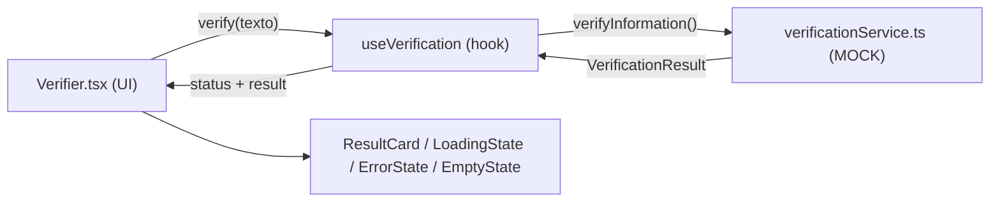

# RELATÓRIO TÉCNICO — FRONT-END BASE DO VERIFICA CIDADÃO

> Documento complementar ao [`CONTEXTO_MESTRE_VERIFICA_CIDADAO.md`](../CONTEXTO_MESTRE_VERIFICA_CIDADAO.md).
>
> **Data:** 09/10/2026
> **Escopo:** o que foi implementado no front-end até agora, decisões técnicas, limitações conhecidas e próximos passos sugeridos.
> **Fase do roadmap:** Fase 1 (front-end base), praticamente concluída.

O CONTEXTO MESTRE descreve **o que o produto deve ser**. Este relatório descreve **o que existe hoje no código**. Os dois devem ser lidos juntos.

---

## 1. Resumo executivo

- Front-end base navegável, feito em **React + TypeScript + Vite + React Router**, sem bibliotecas de UI.
- Identidade visual aplicada a partir do Manual da Marca: cores, tipografia, cantos arredondados, cards.
- **Verificador funcional com dados simulados (mock).** Permite ver as 5 classificações, além dos estados de carregamento, erro e campo vazio.
- Sem backend, banco de dados, autenticação, IA real ou APIs externas, conforme o escopo da Fase 1.
- A camada de serviço já está isolada. Para trocar o mock por uma API real, basta alterar **um arquivo**.
- Página **"Em construção"** estática e separada (`em-construcao/`), pronta para publicar no domínio enquanto o produto não é lançado.
- Logos refeitas a partir do arquivo oficial em alta qualidade, com fundo transparente e sem slogan.

---

## 2. Estrutura do repositório

```text
Verifica-Cidadao/
├── CONTEXTO_MESTRE_VERIFICA_CIDADAO.md   ← contexto conceitual (handoff)
├── MANUAL DA MARCA.pdf                   ← referência visual oficial
├── Sobre o Projeto.docx                  ← documento-base do projeto
├── docs/
│   └── RELATORIO_TECNICO_FRONTEND.md     ← este arquivo
├── app/                                  ← aplicação React (produto)
└── em-construcao/                        ← página estática temporária para o domínio
```

> [!NOTE]
> O projeto **ainda não é um repositório Git**. Recomenda-se inicializar o versionamento antes da próxima etapa (ver seção 9).

---

## 3. Stack e scripts (`app/`)

| Item | Versão / valor |
|---|---|
| React / React DOM | ^19.3.0 |
| React Router DOM | ^7.18.4 (`BrowserRouter`) |
| TypeScript | ^7.0.2 |
| Vite | ^8.3.4 + `@vitejs/plugin-react` |
| CSS | CSS puro, global, organizado por camadas (sem Tailwind, sem CSS-in-JS) |
| Dependências de runtime | Somente React, React DOM e React Router |

```bash
cd app
npm install
npm run dev       # servidor de desenvolvimento
npm run build     # tsc + vite build → app/dist/
npm run preview   # serve o build localmente
```

O build (`tsc && vite build`) foi validado e conclui sem erros.

---

## 4. Arquitetura do front-end

```text
app/src/
├── main.tsx                 # bootstrap + BrowserRouter
├── App.tsx                  # definição das rotas
├── vite-env.d.ts            # tipos do Vite (necessário p/ imports de CSS no tsc)
├── layouts/
│   └── MainLayout.tsx       # Header + <Outlet/> + Footer
├── pages/                   # uma página por rota
├── components/              # componentes reutilizáveis
├── hooks/                   # useVerification, usePageTitle
├── services/                # verificationService (MOCK — ponto de integração)
├── data/                    # conteúdo estático e mocks
├── types/                   # tipos de domínio
└── styles/                  # tokens, base, components, pages
```

### 4.1. Fluxo de dados do Verificador



- **UI** (`Verifier.tsx`): campo, botão, chips de exemplo e painel de demonstração.
- **Hook** (`useVerification.ts`): controla o estado (`idle | loading | success | error | empty`) e descarta respostas antigas quando há uma nova verificação (controle com `runId`).
- **Serviço** (`verificationService.ts`): hoje simula uma latência de cerca de 2s e devolve um resultado mockado.

### 4.2. Rotas

| Rota | Página | Situação |
|---|---|---|
| `/` | `HomePage` | Completa: hero, verificador, classificações, como funciona, módulos, fontes |
| `/como-funciona` | `HowItWorksPage` | Completa (4 passos + princípios) |
| `/fontes` | `SourcesPage` | Completa (fontes de referência, apenas visuais) |
| `/educacao-cidada` | `EducationPage` | Estrutura visual com tópicos futuros |
| `/sobre` | `AboutPage` | Completa (propósito, eixos, princípio "a IA não acusa") |
| `/privacidade` | `PlaceholderPage` | Placeholder |
| `/termos` | `PlaceholderPage` | Placeholder |
| `/contato` | `PlaceholderPage` | Placeholder |
| `*` | `NotFoundPage` | Página 404 |

### 4.3. Componentes

| Componente | Função |
|---|---|
| `Header` | Logo, navegação principal, botão "Entrar" (apenas visual), menu mobile |
| `Footer` | Logo, links institucionais, placeholders de redes sociais, texto institucional |
| `Logo` | Variantes `horizontal`, `full` e `symbol` (arquivos em `public/brand/`) |
| `Verifier` | Campo de verificação, exemplos e painel "Modo demonstração" |
| `ResultCard` | Classificação, resumo, explicação, fontes, data e aviso de limitações |
| `ClassificationBadge` | Selo colorido de cada uma das 5 classificações |
| `ClassificationShowcase` | Vitrine das 5 classificações na Home |
| `SourceCard` | Card de fonte consultada |
| `States` | `LoadingState`, `EmptyState`, `ErrorState` |
| `HowItWorks` | Fluxo em 4 passos |
| `ModulesGrid` | 4 módulos (só o Verificador ativo, os demais aparecem como "Em breve") |
| `EducationGrid` | Grade de tópicos da Educação Cidadã |
| `PrincipleNotice` | Aviso "A IA não acusa" |
| `PageHero` | Cabeçalho padrão das páginas internas |
| `Button`, `Icon` | Botão padronizado e ícones SVG inline (sem biblioteca de ícones) |

### 4.4. Tipos de domínio (`types/index.ts`)

```ts
type Classification =
  | 'confirmada' | 'parcialmente-confirmada' | 'sem-evidencias'
  | 'contradita' | 'analise-humana'

interface VerificationResult {
  id: string
  query: string
  classification: Classification
  summary: string
  explanation: string
  sources: Source[]
  analyzedAt: string // ISO
}

type VerifyStatus = 'idle' | 'loading' | 'success' | 'error' | 'empty'
```

> [!IMPORTANT]
> `VerificationResult` funciona, na prática, como **contrato preliminar com o futuro backend**. Ao desenhar a API (Fase 3), parta desse formato. Provavelmente será preciso acrescentar campos como `evidences`, `limitations`, `confidence` e `claims[]`.

---

## 5. Identidade visual aplicada

### 5.1. Tokens (`styles/tokens.css`)

| Token | Valor | Uso |
|---|---|---|
| `--vc-blue` | `#0B4EA2` | Azul principal |
| `--vc-blue-support` | `#1C73D1` | Azul de apoio |
| `--vc-green` | `#19A866` | Verde verificação |
| `--vc-yellow` | `#F3CA31` | Amarelo destaque |
| `--vc-graphite` | `#404A57` | Texto |
| `--vc-gray-light` | `#E9EDF2` | Fundos e trilhas |
| `--font-title` | Montserrat | Títulos |
| `--font-body` | Inter | Interface e textos |

Também foram definidos tons derivados (`-50`, `-700`, `-deep`), escala de espaçamento (`--sp-1` a `--sp-9`), raios (`--r-sm` a `--r-pill`) e sombras com matiz azul.

### 5.2. Cores das classificações

| Classificação | Cor |
|---|---|
| Confirmada | Verde `#19A866` |
| Parcialmente confirmada | Amarelo `#F3CA31` |
| Sem evidências suficientes | Laranja `#EE8A2A` |
| Contradita pelas fontes | Vermelho `#D93A2F` |
| Necessita de análise humana | Grafite `#404A57` |

### 5.3. Arquivos de marca (`app/public/brand/`)

| Arquivo | Conteúdo |
|---|---|
| `Logo-Verifica-Cidadao.jpeg` | **Original em alta qualidade** (1254×1254, fundo branco, com slogan). Fonte para todos os recortes. |
| `logo-completo.png` | Símbolo + "VERIFICA CIDADÃO", **sem slogan**, fundo transparente |
| `logo-horizontal.png` | Hoje é **idêntico** ao `logo-completo.png` (ver lacuna 8.1) |
| `simbolo.png` | Apenas o símbolo (lupa, check, prédio, balão), fundo transparente. Usado no hero e como favicon. |

Como os recortes foram feitos:
1. Detecção automática dos blocos de conteúdo (símbolo / nome / slogan) por projeção horizontal dos pixels.
2. Corte do slogan e recorte justo nas laterais.
3. Remoção do fundo branco: pixels com RGB > 230 viram transparentes.

> [!WARNING]
> A remoção de fundo foi feita por limiar de cor, não por vetorização. Pode haver um leve serrilhado nas bordas em tamanhos grandes. **Recomendado:** obter os arquivos vetoriais oficiais (SVG/AI/PDF vetorial) com quem criou a marca.

---

## 6. Funcionalidades simuladas (mock)

- **Verificação:** qualquer texto enviado recebe uma das 5 classificações, em rodízio.
- **Forçar um estado (para demonstração):**
  - pelo painel "Modo demonstração", logo abaixo do campo;
  - ou digitando uma tag no texto: `#confirmada`, `#parcialmente-confirmada`, `#sem-evidencias`, `#contradita`, `#analise-humana`, `#erro`.
- **Estados de interface implementados:** inicial, carregando, sucesso, erro (com "Tentar novamente") e campo vazio (com sugestão de exemplo).
- **Fontes:** Governo Federal, Portal da Transparência, Senado, Câmara, TCU e Agência Brasil. São apenas referências visuais (`data/sources.ts`).
- **Exemplos de consulta:** 3 chips prontos (`data/mockResults.ts → exampleQueries`).

Todos os textos dos resultados seguem o princípio **"a IA não acusa"**: linguagem baseada em evidências e sem termos sensacionalistas.

---

## 7. Página "Em construção" (`em-construcao/`)

Página **estática e autossuficiente**, separada do app React, feita para ocupar o domínio até o lançamento.

```text
em-construcao/
├── index.html      # HTML + CSS inline, sem build e sem dependências
└── assets/
    ├── logo.png     # logo sem slogan, 640px, transparente
    └── favicon.png  # símbolo, 192px
```

- **Conteúdo:** logo, selo "Plataforma em construção", título, texto de propósito, barra de progresso, os 3 pilares (IA, Transparência Pública, Educação Cidadã), slogan e rodapé com o ano automático.
- **Responsividade:** validada por captura de tela em 1440px e 390px. No celular, os pilares viram uma lista vertical.
- **Acessibilidade:** respeita `prefers-reduced-motion`, usa `role="status"` e `alt` nas imagens.
- **SEO:** `title`, `description`, `theme-color` e tags Open Graph.
- Usa Google Fonts (Montserrat + Inter) via CDN, por isso precisa de internet para carregar as fontes. Sem internet, cai para as fontes do sistema.

### Como publicar

1. Envie o **conteúdo** de `em-construcao/` (o `index.html` e a pasta `assets/`) para a raiz pública da hospedagem (ex.: `public_html/`).
2. Quando o produto for lançado, substitua pelo conteúdo de `app/dist/`, gerado por `npm run build`.

> [!TIP]
> A tag `og:image` usa caminho relativo (`assets/logo.png`). Algumas redes sociais exigem URL absoluta. Quando o domínio estiver definido, troque por `https://<dominio>/assets/logo.png`.

---

## 8. Lacunas, riscos e pendências conhecidas

### 8.1. Marca
- **Não existe versão horizontal real da logo.** O arquivo oficial é vertical (símbolo acima do nome). Hoje `logo-horizontal.png` = `logo-completo.png`, e o Header usa essa versão vertical em tamanho reduzido. Para ter uma horizontal, é preciso montar símbolo + nome lado a lado, de preferência a partir de vetor.
- Faltam os arquivos vetoriais oficiais (ver aviso na seção 5.3).

### 8.2. Hospedagem do app React
- O app usa `BrowserRouter`. Em hospedagem estática, **é necessário configurar um fallback para `index.html`**. Sem isso, acessar `/sobre` diretamente retorna 404 do servidor. Exemplos:
  - Apache: `.htaccess` com `FallbackResource /index.html`;
  - Netlify: arquivo `_redirects` com `/* /index.html 200`;
  - Vercel: `rewrites` no `vercel.json`.

### 8.3. Escopo vs. CONTEXTO MESTRE (seções 15, 21 e 29)

| Requisito | Situação |
|---|---|
| Cabeçalho com navegação + "Entrar" visual | ✅ |
| Hero com slogan, campo e CTA | ✅ |
| Resultado com classificação, resumo, explicação, fontes, data e aviso | ✅ |
| 5 classificações visualizáveis | ✅ |
| Fontes consultadas | ✅ |
| Como funciona (4 passos) | ✅ |
| 4 módulos (apenas Verificador ativo) | ✅ |
| Página Educação Cidadã (estrutura) | ✅ |
| Rodapé completo | ✅ (redes sociais como placeholder) |
| Estados: inicial, loading, sucesso, erro, vazio | ✅ |
| Estado "fonte indisponível" | ❌ Não implementado |
| Estado "conteúdo não suportado" (ex.: imagem/documento) | ❌ Não implementado |
| Envio de link, imagem ou documento | ❌ Apenas texto e link digitado |
| Seção explícita de "evidências" e "limitações" no resultado | ⚠️ Parcial: há explicação e aviso genérico, sem lista estruturada |
| Responsividade | ✅ Implementada, mas sem teste em dispositivos reais |
| Acessibilidade | ⚠️ Básica (labels, `aria-live`, foco). Sem auditoria formal (Lighthouse/axe). |

### 8.4. Outros
- Sem testes automatizados (unitários ou e2e).
- Sem lint/format configurado (ESLint/Prettier).
- A automação de navegador (Playwright) do ambiente de desenvolvimento falhou ao baixar drivers. As capturas de tela foram feitas com o `chrome-headless-shell` já presente no cache local.
- As fontes vêm do Google Fonts, sem auto-hospedagem. Avaliar isso por privacidade/LGPD antes do lançamento.

---

## 9. Próximos passos sugeridos

Seguem o princípio de **tasks pequenas, auditáveis e reversíveis** (CONTEXTO MESTRE, seção 30).

### Imediato (antes de publicar)
1. **Inicializar o Git** e fazer um commit inicial do estado atual.
2. **Publicar a página `em-construcao/`** no domínio escolhido e ajustar o `og:image` para URL absoluta.
3. **Pedir os vetores oficiais da marca** e gerar uma logo horizontal real para o Header.

### Fase 2 — Refinamento de UX
4. Testar em dispositivos reais (iOS Safari, Android Chrome) e em tablet.
5. Incluir no `ResultCard` blocos estruturados de **Evidências** e **Limitações da análise**.
6. Implementar os estados **"fonte indisponível"** e **"conteúdo não suportado"**.
7. Criar a UI de envio de **link, imagem e documento**, ainda com mock (abas ou seletor no campo).
8. Fazer auditoria de acessibilidade (Lighthouse + axe) e corrigir o que aparecer.
9. Revisar os textos com alguém de comunicação/jurídico, principalmente os avisos de responsabilidade.
10. Configurar ESLint + Prettier e, opcionalmente, testes com Vitest + Testing Library para o hook e o serviço.
11. Escrever o conteúdo inicial de Privacidade, Termos e Contato (hoje são placeholders).

### Fase 3 — Arquitetura do MVP real (só com autorização)
12. Formalizar o contrato da API a partir de `VerificationResult`, adicionando `claims`, `evidences`, `limitations` e `confidence`.
13. Definir o backend, o provedor de IA, o mecanismo de busca/recuperação de fontes, os logs e a rastreabilidade.
14. Trocar o corpo de `verifyInformation()` em `app/src/services/verificationService.ts` por uma chamada HTTP. **O restante da UI não precisa mudar.**
15. Definir a política de dados (LGPD): o que é armazenado, por quanto tempo e com qual anonimização.

### Antes do lançamento do app React
16. Configurar o fallback de SPA na hospedagem (seção 8.2).
17. Remover ou ocultar o painel "Modo demonstração" do Verificador.
18. Auto-hospedar as fontes e revisar meta tags e Open Graph de todas as páginas.

---

## 10. Pontos de entrada rápidos para a próxima IA

| Objetivo | Arquivo |
|---|---|
| Integrar a API real | [`app/src/services/verificationService.ts`](../app/src/services/verificationService.ts) |
| Alterar o estado do verificador | [`app/src/hooks/useVerification.ts`](../app/src/hooks/useVerification.ts) |
| Textos dos resultados mock | [`app/src/data/mockResults.ts`](../app/src/data/mockResults.ts) |
| Rótulos e descrições das classificações | [`app/src/data/classifications.ts`](../app/src/data/classifications.ts) |
| Fontes exibidas | [`app/src/data/sources.ts`](../app/src/data/sources.ts) |
| Textos institucionais, módulos e educação | [`app/src/data/content.ts`](../app/src/data/content.ts) |
| Cores, fontes e espaçamentos | [`app/src/styles/tokens.css`](../app/src/styles/tokens.css) |
| Rotas | [`app/src/App.tsx`](../app/src/App.tsx) |
| Página temporária do domínio | [`em-construcao/index.html`](../em-construcao/index.html) |

---

**Fim do relatório técnico.**
